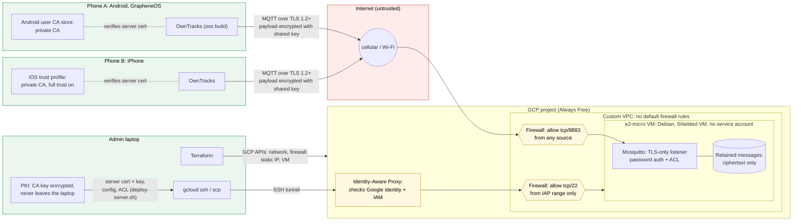
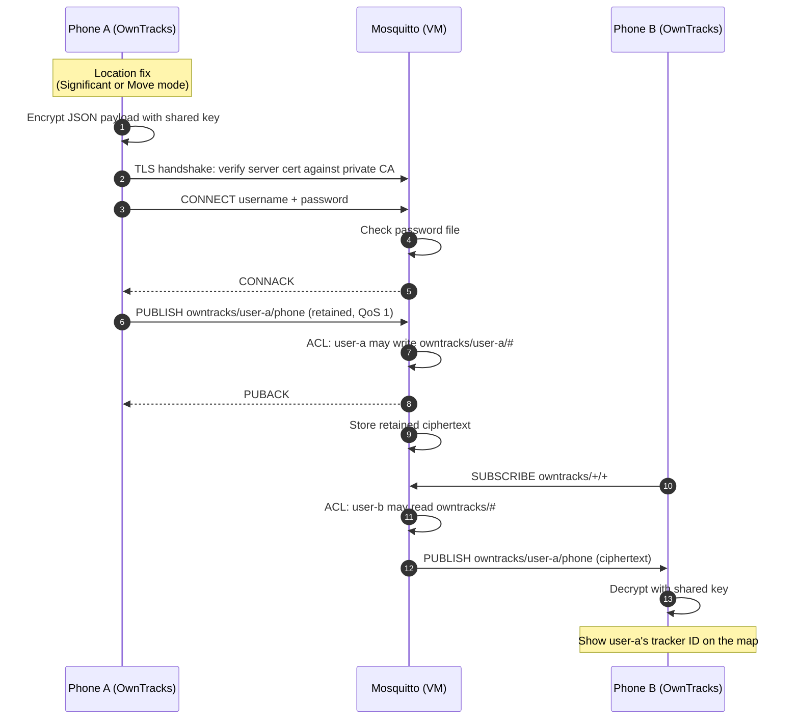

# Architecture

Two views: where data flows and which trust boundary each hop crosses, and what happens to one location update from publish to display. Controls are listed per boundary; [security.md](security.md) has the full threat model.

## Data flow and trust boundaries

### Controls per boundary

| Boundary | Crossing | Controls |
|---|---|---|
| Phone → Internet | Location update | Payload encrypted on the device with a shared key; TLS 1.2+ to the broker |
| Internet → VPC | MQTT connection | Firewall allows tcp/8883 only; TLS server certificate from a private CA name-constrained to the server IP |
| VPC → Mosquitto | Client session | No anonymous access; per-user password (hashed); ACL: write own tree, read shared tree; connection and packet size limits |
| Mosquitto → storage | Retained message | Broker stores ciphertext; coordinates never exist in plaintext on the server |
| Laptop → VM | Administration | No public SSH: IAP checks Google identity and IAM before forwarding; one instance-level key; project SSH keys blocked |
| Laptop → GCP APIs | Infrastructure | Terraform with short-lived Application Default Credentials, revoked after use; dedicated project with budget alert |
| VM → Google APIs | — | Blocked: no service account attached |

## Location update sequence

### What the server can see

| Field | Visible to broker and cloud provider |
|---|---|
| Coordinates, accuracy, battery, speed, tracker ID | No: inside the encrypted payload |
| Username, device ID (topic name), client ID | Yes |
| Connection times, phone source IPs, message sizes | Yes |
